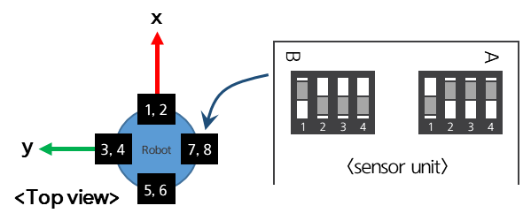

### 4.2.1   센서 유닛 - 제어 유닛 간 통신
센서 유닛과 제어 유닛은 CAN-FD 버스를 사용하여 통신한다. 센서 유닛과 제어 유닛 간의 통신은 진단을 통하여 SIL 2와 PL d 수준을 보장한다. 하나의 제어 유닛에 연결된 다수의 센서 유닛은 서로 다른 ID를 가져야 한다. 내장형 센서 유닛의 ID는 아래 그림과 같이 설치 위치에 따라 부여된다.  
ID를 설정하는 방법은 다음과 같다. ID는 센서 유닛의 4핀 스위치로 설정하며, A 파트에는 홀수, B 파트에는 짝수 ID를 배정한다. 각 핀은 다음과 같은 값을 의미한다.  
- 4번 핀: 1
- 3번 핀: 2
- 2번 핀: 4
- 1번 핀: 8

원하는 ID에 해당하는 핀을 on으로 설정한다. 예를 들어, 센서 유닛의 ID를 7과 8로 지정하려면 아래 그림과 같이 A 파트의 2, 3, 4번 핀과 B 파트의 1번 핀을 on으로 설정한다.  

     </img>

